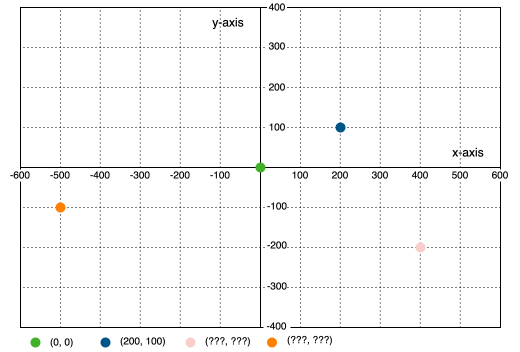
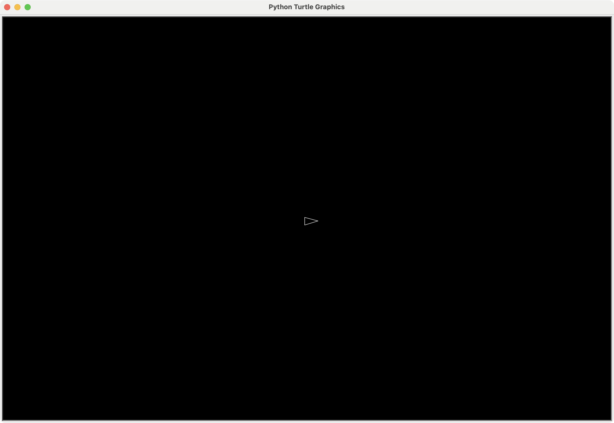

# Lesson 1: Screen and Player
{: .no_toc }

Learn how to set up the game screen and create your first spaceship!
{: .fs-6 .fw-300 }

## Table of contents
{: .no_toc .text-delta }

1. TOC
{:toc}

---

## Install an IDE

**Integrated Development Environment**

### PyCharm Community Edition
- https://www.jetbrains.com/pycharm/download/

- ✅ Download PyCharm Community Edition (**not** Professional edition)
- ✅ Install PyCharm Community Edition

### Get Ready to Code

- ✅ Create a new project in PyCharm

If you don't have Python installed, PyCharm will download a version for you. If asked, choose Python 3.12

- ✅ Create a new file, e.g. `asteroids.py`

---

## Turtle's Coordinate System



---

## Keep Your Code Organized

### Divide code into sections

1. Imports at the top
2. Define constants
3. (Classes) - coming later
4. Game setup
5. Events
6. Behaviours
7. (Game Loop)
8. Start the game

### Example in Python

```python
import turtle
# CONSTANTS, e.g.
SCREEN_WIDTH = 1200  # a constant
# CLASSES, e.g.
class Asteroid(turtle.Turtle): 
# GAME SETUP, e.g.
player = turtle.Turtle()
# EVENTS, e.g.
screen.onkey(press_up, "Up")
# BEHAVIOURS, e.g.
def move_spaceship():
# GAME LOOP, e.g.
def update():
# START THE GAME, e.g.
screen.mainloop()
```

---

## Comments

Everything after a `#` symbol is considered a comment and is ignored by Python.

You don't need to write them, but they're helpful for yourself later.

```python
#
#  GAME SETUP
#

player.penup() # to not draw lines
```

If you write comments, write **why** not **what**.
I might write some **what** comments to help you better understand the code initially.

---

## Let's Get Started

### Start by importing turtle

So we can use it in our code

```python
import turtle
```

- ✅ Put this code in your empty file as the first line

---

## Define Some Constants

This makes it easier to adjust the game later

A constant is a type of variable that doesn't change while the program runs

```python
#
#  CONSTANTS
#

SCREEN_WIDTH = 1200  # Screen width
SCREEN_HEIGHT = 800  # Height
BG_COLOR = "black"   # Background color
```

- ✅ Put this code after the `import` line

---

## Set Up the Screen

```python
#
#  GAME SETUP
#

# Set up the screen
screen = turtle.Screen()
screen.setup(SCREEN_WIDTH, SCREEN_HEIGHT)  # width and height
screen.bgcolor(BG_COLOR)  # background color
screen.tracer(0)  # disable the built in movement animation of turtle
```

This creates the window, sets its size and background color, and disables the built-in movement animation.

- ✅ Put this code after the `# CONSTANTS` section

---

## Create a Spaceship

```python
# Make a turtle for the player
player = turtle.Turtle()
player.shape("triangle")
player.color("light grey", BG_COLOR)
player.penup()  # to not draw lines
```

- Here we use a `triangle` shape for our turtle, set it to light grey with black fill.
- Finally we lift the pen so it doesn't draw lines behind it.

- ✅ Put this code in the `# GAME SETUP` section, after `screen` is set up

---

## Display the Game

```python
#
#  START THE GAME
#

screen.update()  # Since we disabled the tracer, we manually have to update the screen
screen.mainloop()  # don't close the window
```

- Now we need to update the screen with what we've put on it: the spaceship.
- We have to do this manually because we disabled `tracer` (animation).
- The last line calls the `mainloop` function so the program doesn't stop

- ✅ Put this code after the `# GAME SETUP` section

---

## Test the Game

- ✅ Run the game and see how it looks

### Does it look like this?



---

## Complete Code

```python
import turtle

#
#  CONSTANTS
#
SCREEN_WIDTH = 1200
SCREEN_HEIGHT = 800
BG_COLOR = "black"

#
#  GAME SETUP
#
screen = turtle.Screen()
screen.setup(SCREEN_WIDTH, SCREEN_HEIGHT)
screen.bgcolor(BG_COLOR)
screen.tracer(0)  # disable animation

# Make a turtle for the player
player = turtle.Turtle()
player.shape("triangle")
player.color("light grey", BG_COLOR)
player.penup()  # to not draw lines


#
#  START THE GAME
#

screen.update()
screen.mainloop()

```

---

## Make the Spaceship Look Better

We can do this by stretching the triangle a bit:

```python
# Stretch the triangle to be pointy
player.shapesize(stretch_wid=0.75, stretch_len=1.5)
```

- Here we stretch it lengthwise so it looks more like a spaceship

You can also write it shorter:
```python
player.shapesize(0.75, 1.5)
```

- ✅ Put this code in the `# GAME SETUP` section, after the other `player` lines

---

## Next Steps

Great job! You've created the game screen and spaceship. In the next lesson, we'll make the spaceship move!

[Next: Lesson 2 - Move Spaceship →](02-move-spaceship){: .btn .btn-purple }
